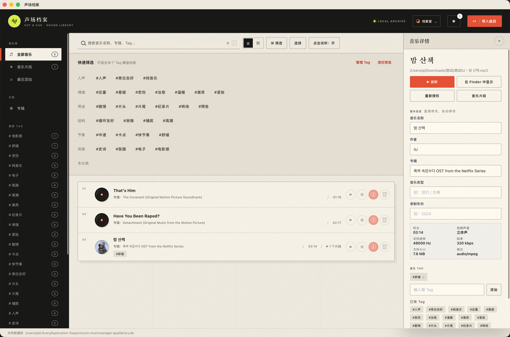
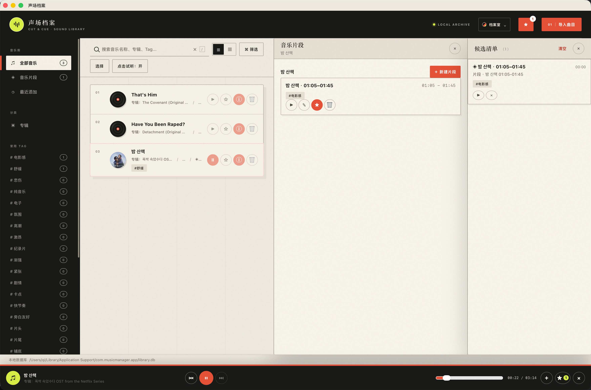
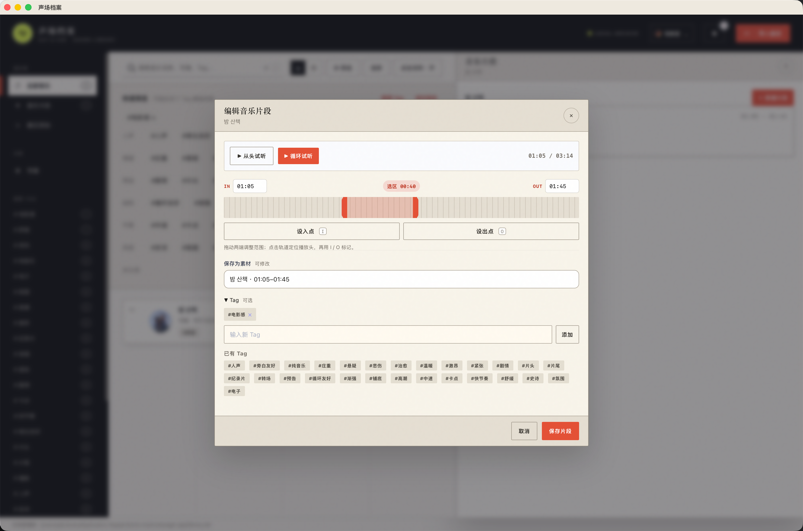

# 声场档案

本地音乐素材管理工具 —— 为剪辑师设计,用来管理、检索、标记音乐素材和片段。

数据用 **SQLite** 存在你本机的应用数据目录(而不是浏览器缓存),**音频文件仍保存在你原来的位置**,应用只记录路径和元数据。清浏览器缓存、清 WebView 缓存都不会影响音乐库。

![技术栈: Tauri v2 + Rust + SQLite + 原生 JS]

## 功能

- **导入音乐**:从磁盘选择或拖入音频文件,自动读取时长,只记录元数据 + 文件路径(不复制文件)
- **多视图检索**:全部音乐 / 音乐片段 / 最近添加 / 专辑 / Tag
- **搜索**:按名称、专辑、Tag 全局搜索
- **标签系统**:给音乐和片段打 Tag,侧边栏常用 Tag 快速筛选
- **片段标记**:在时间轴上拖动起止点,给音乐某一段做标记、命名、打 Tag
- **底部播放器**:点音乐行即内联试听,支持上一首/下一首在列表内连续播放;可在 Finder 中定位原文件
- **候选暂存**:试听时点「＋」把中意的歌加入候选清单,回头统一对比
- **文件重绑**:音乐文件被移动/改名后,可重新选择并绑定新路径

## 界面预览

### 音乐库、筛选与详情



### 底部播放器、音乐片段与候选清单



### 在时间轴中标记音乐片段



## 给使用者的说明(不需要装任何环境)

> 如果你是剪辑师朋友、完全不碰代码 —— 这部分就够了。

你收到的是一个 `.dmg` 安装包，**不需要安装 Node、Rust 或任何开发环境**。新打包流程使用免费的 ad-hoc（临时）签名，未进行 Apple Developer ID 签名或公证；从浏览器下载后，macOS 仍可能要求首次手动允许打开。已经发布的旧包不会自动得到这个签名修复。

### 安装与打开

> 从 v0.2.6 开始，DMG 包含图形化安装与更新入口；v0.2.5 及之前的 DMG 仍是拖拽安装包。旧用户安装新版后继续使用原来的数据库，无需重建或重新导入。请勿将新安装脚本与旧 DMG 混用。

1. 按 Mac 芯片选择 DMG：M 系列下载 `aarch64`；Intel 下载 `x64`。
2. 打开新格式 DMG，双击「安装与更新声场档案」，点击「安装 / 更新」。无需输入命令或安装开发环境。
3. 首次安装到当前用户的「应用程序」文件夹；已有 `/Applications/声场档案.app` 或 `~/Applications/声场档案.app` 会在原位置更新，必要时系统会请求管理员授权。
4. 等待安装窗口显示结果。新电脑没有音乐库配置时，在声场档案窗口中选择「打开已有音乐库」或「创建新音乐库」。移动硬盘没有连接时，按提示连接后重试。

若 macOS 首次阻止安装器打开，请按 **「系统设置 → 隐私与安全性」** 中的单应用允许流程操作，详见 [Apple 说明](https://support.apple.com/zh-cn/102445)。免费的 ad-hoc 签名不等于 Apple Developer ID 签名或公证，不能保证所有系统和设备策略都会允许打开。

### 在 App 内升级

首次安装支持应用内更新的版本后，点击右上角 **「更新」→「下载更新」→「重启并更新」**。程序会匹配 Mac 芯片、验证更新包签名，退出后安全替换并重新打开。日常升级无需再次下载 DMG 或运行脚本。

v0.2.5 及更早的已发布版本没有此入口，需要先手动安装首个支持更新的版本。发布方需先配置更新签名 Secret，详见 [安装与更新说明](docs/macos-installer.md)。

**已有音乐库直接沿用**：更新安装只替换应用，保留本机 `settings.json` 和原 `library.db` 路径。新版打开同一份数据库，继续使用原有音乐、标签、片段、专辑标签和候选清单，无需重建或重新导入；数据库在移动硬盘上时，请先连接原硬盘。缺少位置配置的旧默认库只需选择「打开已有音乐库」，指向原 `library.db` 所在文件夹，之后会记住位置。

需要升级数据库结构时，程序先在原库旁生成包含已提交 WAL 数据的 SQLite 备份，再在一个事务中完成迁移和关联校验。失败会撤销整次迁移，保留原数据与备份；重试不会覆盖已有备份，也不会把原库替换为空库。

### 更新失败时

保留 DMG，重新打开其中的安装窗口即可：

- **重新尝试启动**：确认本次启动的实际结果，区分界面就绪、等待选择音乐库、音乐库不可用及启动失败。
- **恢复旧版**：先退出应用并检查数据库兼容性，再恢复旧应用。音乐库不会被恢复操作复制或覆盖。无法确认兼容性、硬盘未连接、旧版早于 v0.2.5 且缺少安全元数据时，会保留备份并停止恢复。
- **导出诊断信息**：保存 ZIP 发给开发者，无需自己找日志。每次启动的日志独立保留，重试不会覆盖首次失败信息。不包含数据库、位置配置文件或音频，但日志和崩溃报告可能包含本机路径，请仅发给信任的人。

新版先复制、校验，再退出旧应用并保留备份。替换失败时会尝试恢复原应用；启动失败不会擅自降级。异常断电后可重新打开安装窗口处理未完成的更新。

`scripts/install-macos.sh` 仅保留旧命令的兼容入口，`--replace` 会打开同一个安装窗口，不再直接移除旧应用。旧 DMG 缺少图形化入口时会停止，要求下载新版。

### 数据存在哪里

- 本机位置配置：`~/Library/Application Support/com.musicmanager.app/settings.json` 中的 `db_path` 记录数据库路径。没有这份配置时，不推断是否首次使用，而是让用户明确选择「打开已有音乐库」或「创建新音乐库」；创建还需选择保存目录并确认，不会自动生成默认空库。
- 底部「切换音乐库」用于打开所选文件夹中的 `library.db`，不会搬迁、复制、合并或覆盖当前音乐库；目录内没有数据库时，会先确认是否创建空音乐库。切换成功后刷新界面并记住位置，原数据库保留。
- 换电脑时，连接移动硬盘，在启动选择框中点击「打开已有音乐库」，选择旧 `library.db` 所在文件夹即可读取原有音乐、标签和片段；已进入应用时也可点击「切换音乐库」。复制数据库到其他设备前，应先关闭使用该库的应用，确保 SQLite WAL 中的数据已写回。
- 已设置的音乐库不可用时，启动会停止加载并提示连接移动硬盘，可在接好硬盘后点击「重试」或选择「退出」；不会补建目录、生成替代空库或回退到默认库。位置设置损坏时同样停止加载，不会静默使用空库。
- **音频文件不复制、不移动**,还在你原来的文件夹里
- 新导入的音乐会保存 macOS 文件书签。即使随后在 Finder 中移动或重命名文件，下次打开应用或播放前会自动更新库内路径；文件被删除或跨磁盘复制后再删除时才可能需要重新绑定。
- 若导入时选择「以文件夹名称为准」，每次启动同步路径时也会同步最新父文件夹名称为专辑名。升级前已有音乐会默认迁移为此来源，可在详情中改成 MP3 属性或手动填写；手动填写的音乐不受文件夹改名影响。

### 注意

- 应用内删除音乐/片段 = 从音乐库移除记录,**不会删除磁盘上的音频文件**
- 清空浏览器缓存对应用数据**没有任何影响**

## 给开发者的说明

### 项目结构

```
music-manager/
├── frontend/                # 前端(原生 JS + HTML + CSS,零框架零构建)
│   ├── index.html           # 主界面(含底部播放器、候选面板)
│   ├── app.js               # 全部逻辑
│   └── style.css            # 样式
└── src-tauri/               # Tauri v2 桌面壳
    ├── src/
    │   ├── main.rs          # 入口
    │   ├── lib.rs           # Builder 组装、数据库 setup
    │   ├── db.rs            # SQLite 连接 / 建表 / WAL
    │   └── commands.rs      # 全部 #[tauri::command]
    ├── tauri.conf.json
    ├── Cargo.toml
    └── capabilities/
```

### 技术要点

- **后端**:Tauri v2 + Rust,`rusqlite`(bundled SQLite)存本地数据库
- **前端**:原生 JS,通过 `window.__TAURI__` 全局 API 调 `invoke`,不引入 npm 包
- **音频**:库只存绝对路径,播放/剪辑时用 `convertFileSrc` + asset 协议把本地文件喂给 `<audio>`(已验证 WKWebView 下 seek 正常)
- **位置配置**:`app.path().app_data_dir()/settings.json`；数据库在用户明确选择的文件夹内。旧默认库可在 `~/Library/Application Support/com.musicmanager.app/library.db` 找到，缺配置时也需明确选择打开。
- **替换了原版 IndexedDB + File System Access API**:原版数据存浏览器、清缓存即丢,这是迁移为桌面应用的根本原因

### 环境要求

| 工具 | 版本 | 用途 |
|---|---|---|
| Rust | stable | 编译 Rust 侧 |
| [tauri-cli](https://github.com/tauri-apps/tauri) | 2.x | 开发/打包(`cargo install tauri-cli --locked`) |
| Xcode Command Line Tools | macOS | 编译 |

### 开发

```bash
# 安装 Rust(如果还没有)
curl --proto '=https' --tlsv1.2 -sSf https://sh.rustup.rs | sh
# 安装 tauri-cli
cargo install tauri-cli --locked

# 启动开发模式(首次编译较慢)
cd src-tauri && cargo tauri dev
```

改 `frontend/` 下的文件后,刷新应用即可看到(无热重载,手动刷新窗口)。

数据库启动与切换的回归检查：`node --test scripts/test-database-switch.cjs`；后端测试：`cd src-tauri && cargo test --locked --lib`。覆盖硬盘未连接、数据库缺失、设置损坏、连接后重试、已有库和 WAL 数据保留、空目录确认创建、无效库拒绝、设置保存失败及切换时的在途操作。

### 打包

发布前同步更新 `src-tauri/Cargo.toml`、`Cargo.lock` 与 `src-tauri/tauri.conf.json` 的版本号，再创建相同版本的 `v` 标签。GitHub Actions 分别在 Apple Silicon 和 Intel runner 上测试、构建应用及图形化安装 DMG。

本地从项目根目录构建（以 Apple Silicon 为例）：

```bash
rustup target add aarch64-apple-darwin
(cd src-tauri && cargo tauri build --bundles app --target aarch64-apple-darwin)
bash scripts/build-macos-installer.sh \
  "$PWD/src-tauri/target/aarch64-apple-darwin/release/bundle/macos/声场档案.app" \
  "$PWD/music-manager_VERSION_aarch64.dmg"
```

Intel 使用 `x86_64-apple-darwin`，DMG 文件名后缀使用 `x64`。打包脚本要求输出路径尚不存在，拒绝架构不明确、缺少启动协议或数据库版本元数据不匹配的应用。

应用和安装器均进行完整 ad-hoc 签名，发布前校验签名与 DMG 完整性。编译 Swift 只发生在开发者/CI 环境，使用者无需安装 Swift、Python、Node 或 Rust。免费签名不能代替 Apple 公证。

安装器回归测试：`bash scripts/test-macos-installer.sh`。更多实现细节及测试边界见 [安装器说明](docs/macos-installer.md)。

### 常用命令(增删改查)

前端通过 `window.__TAURI__.core.invoke` 调用,完整清单见 `src-tauri/src/commands.rs`:

| 命令 | 作用 |
|---|---|
| `init_db` | 确认数据库就绪 |
| `probe_file` | 读取文件路径的元数据(名称/大小/mime) |
| `create_music` / `update_music` / `delete_music` / `get_music` / `list_music` | 音乐表 CRUD |
| `create_clip` / `update_clip` / `delete_clip` / `get_clip` / `list_clips` | 片段表 CRUD |
| `file_exists` | 判断音频文件是否还在 |

### 数据模型

数据库为 SQLite(文件 `library.db`,WAL 模式、外键开启)，当前 schema 版本为 `3`。所有 `*_at` 时间字段均为毫秒时间戳(INTEGER)。

旧版 Tag 数据库首次升级时会先通过 SQLite 生成 `library.pre-tag-tree-v1.db` 完整备份；其他结构升级或失败后的再次升级使用唯一命名的 `library.pre-schema-3-*.db`，保留已有备份。全部结构与数据迁移在同一个事务中完成，关联校验通过后才提交。恢复旧应用必须先确认它能读取当前数据库，不自动回滚数据库，也不要直接用旧备份覆盖已经继续编辑过的库。程序检测到高于自身支持范围的 schema 版本时会停止写入。

**music**(主键 `id`,音乐元数据;只存路径,不存音频文件本身)

| 字段 | 类型 | 说明 |
|---|---|---|
| id | TEXT PK | `music_<时间戳>_<随机>` |
| name | TEXT NOT NULL | 音乐名 |
| file_name | TEXT NOT NULL DEFAULT '' | 完整文件名 |
| path | TEXT NOT NULL(唯一索引) | 音频文件**绝对路径** |
| album | TEXT DEFAULT '' | 专辑 |
| artist | TEXT DEFAULT '' | 艺术家 |
| genre | TEXT DEFAULT '' | 流派 |
| year | TEXT DEFAULT '' | 年份 |
| channels | TEXT DEFAULT '' | 声道(单声道/立体声) |
| sample_rate | INTEGER DEFAULT 0 | 采样率(Hz) |
| bitrate | INTEGER DEFAULT 0 | 码率(kbps) |
| duration | REAL DEFAULT 0 | 时长(秒) |
| file_size | INTEGER DEFAULT 0 | 文件大小(字节) |
| mime_type | TEXT DEFAULT '' | 音频 MIME |
| created_at / updated_at | INTEGER NOT NULL | ms 时间戳 |

索引:`name`、`album`、`artist`、`genre`、`year`、`created_at`、`path`(唯一)。

**clips**(主键 `id`,音乐片段;外键关联 music,级联删除)

| 字段 | 类型 | 说明 |
|---|---|---|
| id | TEXT PK | `clip_<时间戳>_<随机>` |
| music_id | TEXT NOT NULL FK→music(id) ON DELETE CASCADE | 所属音乐 |
| name | TEXT NOT NULL DEFAULT '未命名片段' | 片段名 |
| start | REAL NOT NULL CHECK(start >= 0) | 起点(秒) |
| end | REAL NOT NULL CHECK(end > start) | 终点(秒) |
| created_at / updated_at | INTEGER NOT NULL | ms 时间戳 |

索引:`music_id`、`created_at`。

**tags / tag_categories**(树形标签与筛选维度)

`tags`:

| 字段 | 类型 | 说明 |
|---|---|---|
| id | INTEGER PK AUTOINCREMENT | 标签 id |
| name | TEXT NOT NULL COLLATE NOCASE | 标签名；同一父节点内不区分大小写且唯一 |
| category_id | INTEGER NOT NULL FK→tag_categories(id) ON DELETE RESTRICT | 所属筛选维度 |
| parent_id | INTEGER NULL FK→tags(id) ON DELETE RESTRICT | 父 Tag；NULL 表示维度根节点 |
| created_at | INTEGER NOT NULL | ms 时间戳 |

`tag_categories`:

| 字段 | 类型 | 说明 |
|---|---|---|
| id | INTEGER PK AUTOINCREMENT | 筛选维度 id |
| name | TEXT NOT NULL UNIQUE COLLATE NOCASE | 筛选维度名 |
| created_at | INTEGER NOT NULL | ms 时间戳 |

**music_tags / clip_tags**(音乐/片段与标签的多对多关联)

| 表 | 字段 | 说明 |
|---|---|---|
| music_tags | (music_id FK→music CASCADE, tag_id FK→tags CASCADE, PK(music_id, tag_id)) | 音乐-标签关联 |
| clip_tags | (clip_id FK→clips CASCADE, tag_id FK→tags CASCADE, PK(clip_id, tag_id)) | 片段-标签关联 |

索引:两表均在 `tag_id` 上有索引。

**candidate_entries**(候选暂存,多态引用 music 或 clips)

| 字段 | 类型 | 说明 |
|---|---|---|
| target_id | TEXT PK | 目标 music/clips 的 id |
| kind | TEXT NOT NULL CHECK(kind IN ('music','clip')) | 目标类型 |
| created_at | INTEGER NOT NULL | ms 时间戳 |

> 通过触发器 `trg_music_candidate_cleanup` / `trg_clips_candidate_cleanup`,删除 music/clips 时自动清理对应候选记录。

## License

私有项目,仅供内部分发使用。
